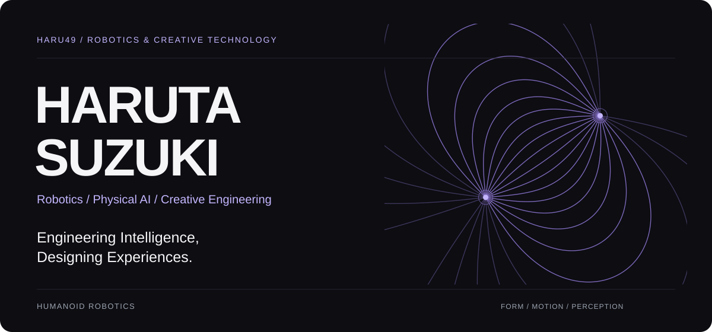
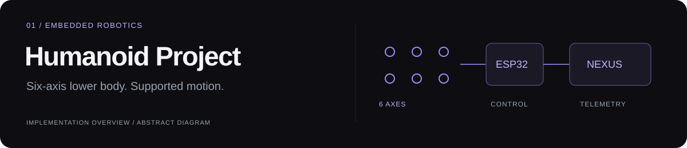
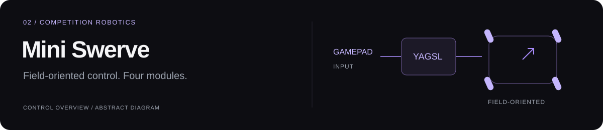
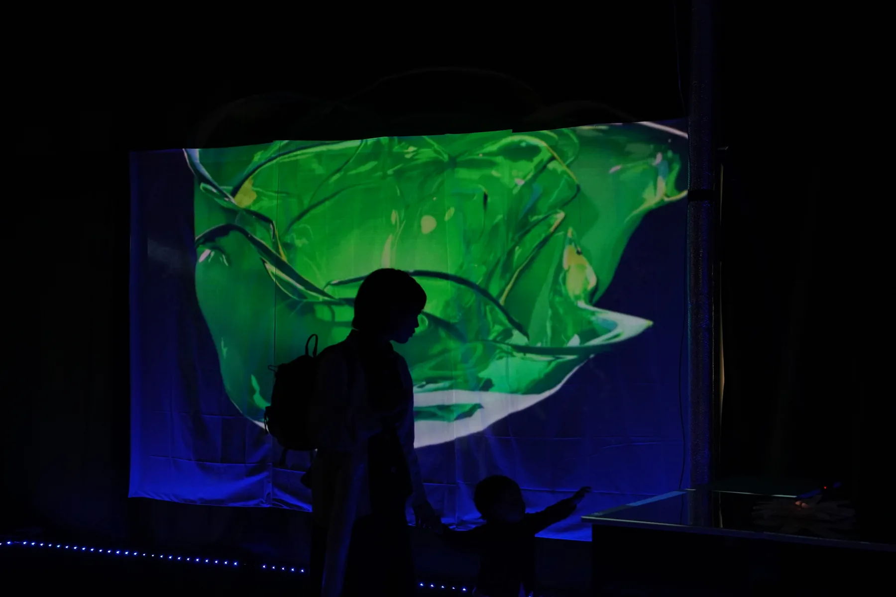

<picture>
  <source media="(max-width: 600px)" srcset="assets/hero-mobile.svg">
  
</picture>

**Haruta Suzuki** · Student at Kamiyama Marugoto College of Technology · Japan

[Selected work](#02-selected-work) · [Experience](#03-experience) · [Portfolio](https://haru49.github.io/portfolio/)

## 01. About

I’m building a humanoid robot and creating interactive art. My work connects hardware, control software, and the experiences people have with them. At Kamiyama Marugoto College of Technology in Japan, I study design, engineering, and entrepreneurship. My robotics experience includes FRC robot development and the FIRST Global Challenge 2025 with Team Japan.

I’m interested in how machines sense, move, and interact with the physical world, and how those interactions can become meaningful experiences. I’m working toward research and development in robotics.

## 02. Selected work

### Humanoid Project

A humanoid robot in development, bringing together ESP32 firmware, servo control, calibration, supported motion sequences, and a local telemetry interface, NEXUS. The current work focuses on a six-axis lower body, supported alternating steps, and understanding motion through joint and IMU telemetry.

**Built with** C++ · ESP32-S3 · PlatformIO · TypeScript · Serial telemetry

[Explore the repository →](https://github.com/Haru49/humanoid-project)

### Mini Swerve / Team 9494

A mini-swerve robot control project for FRC Team 9494. The implementation includes field-oriented driving, heading reset, module locking, and pose telemetry. The public code currently focuses on teleoperated drive control.

**Built with** Java · WPILib · YAGSL · GradleRIO

[Explore the repository →](https://github.com/Haru49/Team9494_TurretSwerve)

### Kinetic Canvas

*From the 2025 installation, documented in my portfolio.*

Interactive art combining projected visuals and exhibition space. I use TouchDesigner to explore how images, movement, and an audience’s presence can shape an experience. The portfolio documents the 2025 work and a 2026 edition in progress.

**Tools & medium** TouchDesigner · Interactive visuals · Spatial design

[View the project →](https://haru49.github.io/portfolio/?project=project-kinetic-canvas) · [Portfolio source →](https://github.com/Haru49/portfolio)

## 03. Experience

- **FIRST Robotics Competition** — Robot development across hardware and software.
- **FIRST Global Challenge 2025 · Team Japan** — International robotics team experience.

## 04. Tools I work with

| Area | Languages & tools |
| :--- | :--- |
| Embedded & robotics | C++ · ESP32-S3 · PlatformIO · Servo motors · IMU |
| Competition robotics | Java · WPILib · YAGSL · GradleRIO |
| Interfaces | TypeScript · JavaScript · React · Vite · HTML / CSS |
| Creative work | TouchDesigner · Interactive visuals · Spatial design |

## 05. Currently exploring

Humanoid robotics · Physical AI · Autonomous systems · Computer vision · Interactive physical art

## 06. Connect

[GitHub](https://github.com/Haru49) · [Portfolio](https://haru49.github.io/portfolio/)

*Building systems that move. Creating experiences that matter.*
